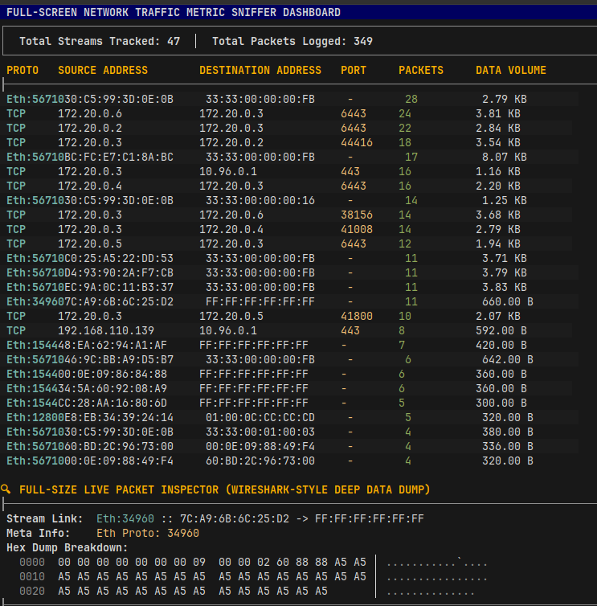
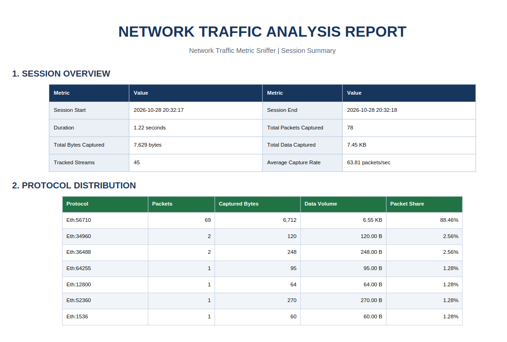

# Network Packet Sniffer

A Python-based packet analysis and monitoring tool that captures network traffic from a raw socket, parses Ethernet, IPv4, TCP, UDP, and ICMP packets, and generates a professional PDF report of the traffic observed during the capture session.

### Application Dashboard


## Overview

This project is designed to monitor live network traffic in real time and present it in a clean terminal-based dashboard. It captures packets directly from the network interface, decodes relevant protocol headers, tracks active streams, and produces a PDF report for later review.

The tool is particularly useful for:

- Live packet monitoring
- Protocol-level packet inspection
- Traffic stream tracking
- Hex/ASCII payload preview
- Report generation for captured network sessions

## Project Architecture

The project follows a modular architecture to separate packet parsing, formatting, preview, and report generation.

```text
Network-Packet-Sniffer/
├── sniffer.py                     # Main entry point; captures packets and renders dashboard
├── requirements.txt               # Python dependencies
├── README.md                     # Project documentation
├── data_link_layer/
│   ├── __init__.py
│   └── mac.py                    # Ethernet frame parsing
├── transport_layer/
│   ├── __init__.py
│   ├── ipv4.py                  # IPv4 packet decoding
│   ├── tcp.py                   # TCP segment parsing
│   ├── udp.py                   # UDP datagram parsing
│   └── icmp.py                  # ICMP packet parsing
├── formatting/
│   ├── __init__.py
│   └── formatting.py            # Human-readable byte formatting helpers
├── preview/
│   ├── __init__.py
│   └── preview_logic.py         # Hex dump / payload preview utilities
├── report_generation/
│   ├── __pycache__/
│   └── pdf_report_generation.py # PDF report creation logic
├── reports/
│   └── dummy_report.pdf         # Example generated report output
└── .gitignore
```

### Architecture Flow

1. Raw packets are captured from the network interface using a socket.
2. Ethernet frames are parsed in `data_link_layer/mac.py`.
3. IPv4 packet information is decoded in `transport_layer/ipv4.py`.
4. TCP, UDP, or ICMP payloads are parsed based on the protocol value.
5. The live dashboard displays connection streams and a hex preview of the latest packet.
6. Final packet metadata and summaries are exported to a PDF using `report_generation/pdf_report_generation.py`.
7. Generated reports are saved in the `reports/` directory.

## Features

- Real-time network packet capture
- Ethernet, IPv4, TCP, UDP, and ICMP parsing
- Multi-stream traffic summary in the terminal dashboard
- Packet payload hexdump preview
- PDF report generation with summary tables and packet details
- Output stored in `reports/`

## Required Setup

### Prerequisites

Before running the project, make sure you have:

- Linux-based operating system
- Python 3.8 or newer
- Root or sudo privileges for raw packet capture
- Network interface access (for example, Wi-Fi or Ethernet adapter)

### Install Python dependencies

```bash
cd Network-Packet-Sniffer
python3 -m venv venv
source venv/bin/activate
pip install -r requirements.txt
```

### Required packages

The project depends on the following packages listed in `requirements.txt`:

```bash
pip install charset-normalizer==3.5.2
pip install pillow==13.0.0
pip install reportlab==5.1.0
```

## Run the Project

Run the sniffer with administrative privileges:

```bash
sudo python3 sniffer.py
```

If you are using a virtual environment, activate it first:

```bash
source venv/bin/activate
sudo python3 sniffer.py
```

## Important Notes

- This project uses raw sockets and is intended for Linux environments.
- Packet capture may require root/admin permission.
- Sniffing network traffic may be restricted depending on your system, network permissions, and local policies.
- Use only on networks where you have explicit permission to monitor traffic.

## Project Execution Behavior

When the program starts, it:

- opens a raw packet socket,
- continuously receives incoming packets,
- identifies protocols and addresses,
- tracks packet counts and byte totals,
- updates a live terminal dashboard,
- and generates a PDF report when the capture is interrupted.

## Report Generation



The project saves reports in the `reports/` directory. Each generated report file contains:

- session overview,
- protocol distribution,
- top traffic streams,
- full stream inventory,
- last packet inspection,
- payload hex preview.

## Example Report Output

An example report file is already included in the repository:

- `reports/dummy_report.pdf`


## Contributing

Contributions are welcome. To improve the project you can:

- add additional protocol support,
- improve packet parsing accuracy,
- add packet filtering controls,
- enhance report visualization,
- or optimize dashboard rendering.

## Contact / Notes

This repository is a network monitoring and packet analysis project, and the main logic is centered around `sniffer.py` along with protocol-specific parsing modules.

If you are using this project for academic or learning purposes, it can serve as a useful foundation for understanding:

- packet structure,
- raw socket communication,
- protocol parsing,
- traffic analysis,
- and report generation using Python.

---
